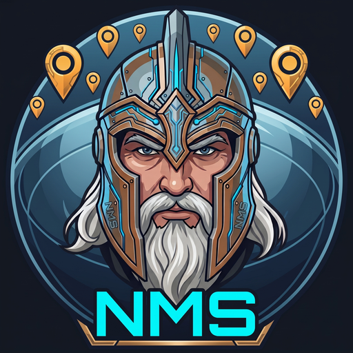
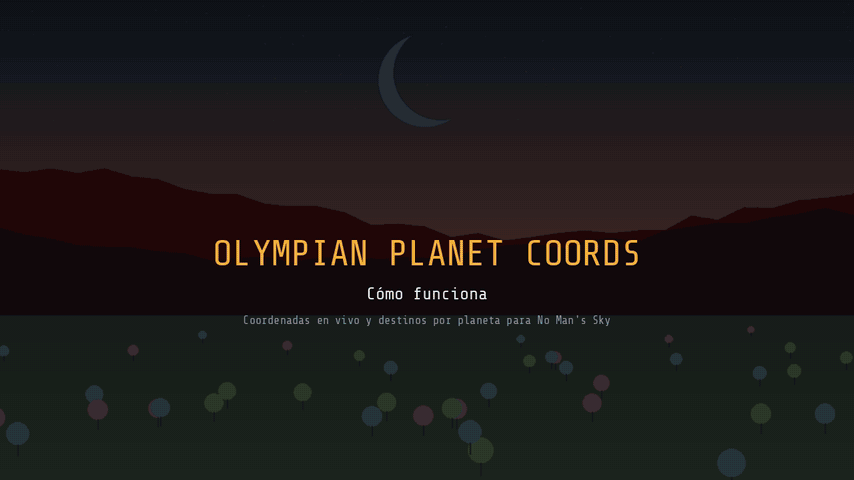

<p align="center"></p>

<h1 align="center">Olympian Planet Coords</h1>

<p align="center">Coordenadas del planeta en vivo y destinos por planeta para <b>No Man's Sky</b> en Windows.<br>
Escribe una latitud y una longitud, y obtienes un marcador en el HUD y una flecha 3D que te guía hasta ahí.</p>

<p align="center"><a href="README.md">Read in English</a> · <a href="INSTRUCCIONES.md">Instrucciones</a> · <a href="CHANGELOG.md">Registro de cambios</a></p>

## Míralo en acción

<p align="center"></p>

<p align="center"><sub>Recuadro y lógica del mod reales; el paisaje y el marcador del HUD son ilustraciones.</sub></p>

## Qué hace (v0.1.0-beta)

- **Coordenadas en vivo** arriba a la izquierda: a pie, en nave, en vehículo y en órbita.
- **Destinos:** haz clic en el recuadro (o pulsa **F9** en el juego), escribe `lat, lon [nombre]`, pulsa **Enter** y aparece un marcador en el HUD del juego.
- **Distancia y rumbo** al destino, y una **flecha 3D** con bordes suaves que gira e inclina hacia él.
- **Llegada:** a 50 m o menos el destino se quita solo y la flecha se convierte en una esfera.
- **Un destino por planeta**, recordado aunque te vayas; historial de los últimos 10.
- Tamaño **Normal / Grande**, tecla configurable e interfaz en **español o inglés**.

## Estado

La **v0.1.0-beta** es la primera versión para jugadores: un `winmm.dll` que se copia en la carpeta `Binaries` del juego y un programa para el recuadro (`OlympianPlanetCoords-Overlay.exe`). No necesita Python ni NMS.py. Funciona con No Man's Sky build **185034**; con cualquier otra, el DLL se desactiva solo y el juego funciona normal. Se descarga en la página de [Releases](https://github.com/ImMightyZeus/Olympian-Planet-Coords/releases).

Instalación y uso: [INSTRUCCIONES.md](INSTRUCCIONES.md).

La **versión de laboratorio** en Python (`mod/`, funciona con [NMS.py](https://github.com/monkeyman192/NMS.py)) sigue sirviendo para probar cambios en el juego real antes de pasarlos al DLL: [mod/INSTRUCCIONES_NMSPY.md](mod/INSTRUCCIONES_NMSPY.md).

## Lo que hace y lo que no hace Olympian Planet Coords

Todo mod o editor cambia el juego, y Olympian Planet Coords no es la excepción. Lo que lo distingue no es una superioridad moral, sino estos compromisos de seguridad:

1. **Solo presentará resultados que el juego podría producir por sí mismo**, siguiendo sus propias reglas y límites. Nunca dejará tu partida en un estado imposible.
2. **Solo modificará aquello que se sabe con certeza; no destruirá tus saves.** No aplicará funciones experimentales de alto riesgo: ya el riesgo lo corremos por ti, con pruebas reales continuamente monitoreadas. De todo lo demás podremos mostrarte una lectura, pero hasta no definir un método seguro, no ofreceremos edición.
3. **Tratará de mantener tu experiencia del juego lo más fiel posible** (sin dejar de ofrecer mejoras opcionales). Verás que ofrece herramientas para resolver problemas reales, no atajos para "tenerlo todo".
4. **Pondrá tu seguridad primero:** respaldos antes de cualquier cambio a tu partida, lo mínimo invasivo posible y avisos claros cuando algo tenga riesgo.
5. **Será transparente:** código abierto, sin relación con Hello Games, y explicará qué hace y qué no hace cada función.

En este mod: solo lee la posición del jugador y pone un marcador del HUD como los que el juego ya usa. No modifica la partida guardada, el inventario ni nada que se guarde en el save.

## Aviso

Proyecto hecho por fans, sin relación con Hello Games. No Man's Sky es una marca de Hello Games. Úsalo bajo tu propia responsabilidad.

## Divulgación sobre el uso de IA

El uso de nuevas tecnologías forma parte del día a día de este y de otros proyectos de MightyZeus. Olympian Planet Coords se desarrolla con la ayuda de una IA (Claude), que participa en la escritura y revisión del código; la dirección del proyecto, qué funciones entran y cuáles se dejan fuera a propósito, y las pruebas en el juego real son trabajo humano.
El compromiso de fondo no cambia: crear soluciones y herramientas reales desde la perspectiva de un jugador apasionado por disfrutar del juego y por ayudar a otros a hacerlo.

## Licencia

[GNU General Public License v3.0](LICENSE). Componentes de terceros:

- NMS.py / pyMHF — monkeyman192, MIT (los patrones de `dll/tools/nmspy_data_185034.json` vienen de NMS.py; ver `dll/tools/NMS.py-LICENSE.txt`).
- MinHook — Tsuda Kageyu, BSD-2-Clause (`dll/third_party/MinHook-LICENSE.txt`).
- JSON for Modern C++ (nlohmann/json) — Niels Lohmann, MIT (`dll/third_party/nlohmann/LICENSE.MIT`).
- Pillow — MIT-CMU (incluido en el `.exe` del recuadro; en la versión de laboratorio se instala aparte).
- Python (PSF) y el cargador de PyInstaller (GPL con excepción), incluidos en el `.exe` del recuadro.
- Fuentes DSEG7 Classic y Share Tech Mono — SIL Open Font License 1.1 (`overlay/fonts/`).

## Créditos

```
Olympian Planet Coords — Copyright © 2026 MightyZeus · Licencia GPL-3.0
Apoya el proyecto: https://paypal.me/ImMightyZeus · Repositorio: https://github.com/ImMightyZeus/Olympian-Planet-Coords

Agradecimientos:
A mi querida esposa y mi amada familia, por permitirme seguir siendo un niño aun en mi adultez.
Pangro Daer Barun D'Gross, por seguirme corrompiendo con videojuegos.
Fenrir, porque aunque ya casi no juega, aún se presta a conversar sobre mis aventuras y desventuras.
```

## Otros proyectos de MightyZeus para No Man's Sky

- **Olympian NMS Save Editor**: editor de partidas seguro y visual (PC/Steam). https://github.com/ImMightyZeus/Olympian-NMS-Save-Editor

Todos los proyectos: https://github.com/ImMightyZeus

## Desarrollo

```
mod/        mod de NMS.py (versión de laboratorio)
overlay/    recuadro y flecha (tkinter + Pillow)
tests/      pruebas que corren sin el juego
dll/        versión DLL para jugadores (mingw-w64 + MinHook)
```

Pruebas (Python 3.12+, Linux o Windows):

```
pip install nmspy==185034.0 pillow fastapi uvicorn httpx
cd tests && python test_mod.py && python test_overlay.py
```

DLL: `cd dll && sh build.sh` (requiere `x86_64-w64-mingw32-g++`). Pruebas del núcleo del DLL contra la versión Python (y, con Wine, el DLL completo con un juego falso): `python dll/tests/test_dll_core.py`.
