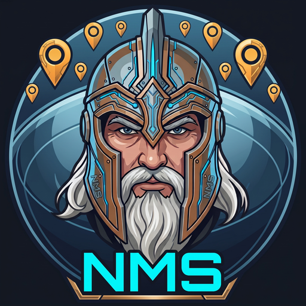
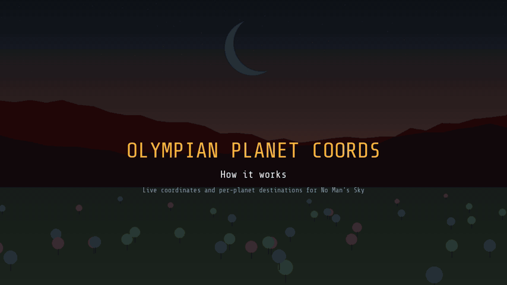

<p align="center"></p>

<h1 align="center">Olympian Planet Coords</h1>

<p align="center">Live planet coordinates and per-planet destinations for <b>No Man's Sky</b> on Windows.<br>
Type a latitude and longitude, get a HUD marker and a 3D arrow that guides you there.</p>

<p align="center"><a href="README.es.md">Leer en español</a> · <a href="INSTRUCTIONS.md">Instructions</a> · <a href="CHANGELOG.md">Changelog</a></p>

## See it in action

<p align="center"></p>

<p align="center"><sub>Real overlay and real mod logic; the landscape and the HUD marker are illustrations.</sub></p>

## What it does (v0.1.0-beta)

- **Live coordinates** in the top-left corner: on foot, in a ship, in a vehicle and in orbit.
- **Destinations:** click the box (or press **F9** in game), type `lat, lon [name]`, press **Enter**, and a marker appears on the game's HUD.
- **Distance and bearing** to the destination, plus a smooth-edged **3D arrow** that turns and tilts towards it.
- **Arrival:** at 50 m or less the destination clears itself and the arrow turns into a sphere.
- **One destination per planet**, remembered even if you leave; history of the last 10.
- **Normal / Large** size, a configurable hotkey, and the interface in **English or Spanish**.

## Status

**v0.1.0-beta** is the first version for players: a `winmm.dll` you copy into the game's `Binaries` folder plus an overlay program (`OlympianPlanetCoords-Overlay.exe`). No Python or NMS.py needed. It works with No Man's Sky build **185034**; with any other build the DLL disables itself and the game runs normally. Download it from the [Releases](https://github.com/ImMightyZeus/Olympian-Planet-Coords/releases) page.

Installation and usage: [INSTRUCTIONS.md](INSTRUCTIONS.md).

The Python **lab version** (`mod/`, runs on [NMS.py](https://github.com/monkeyman192/NMS.py)) is still used to test changes in the real game before they reach the DLL: [mod/INSTRUCTIONS_NMSPY.md](mod/INSTRUCTIONS_NMSPY.md).

## What Olympian Planet Coords does and doesn't do

Every mod or editor changes the game, and Olympian Planet Coords is no exception. What sets it apart isn't moral superiority, but these safety commitments:

1. **It will only produce results the game could produce on its own**, following its own rules and limits. It will never leave your save in an impossible state.
2. **It will only change what is known with certainty; it will not destroy your saves.** It will not apply high-risk experimental features: we already take that risk for you, with real tests that are continuously monitored. For everything else we may show you a reading, but until a safe method is defined, we will not offer editing.
3. **It will try to keep your game experience as faithful as possible** (while still offering optional improvements). You'll see that it offers tools that solve real problems, not shortcuts to "have everything".
4. **It will put your safety first:** backups before any change to your save, as little intrusion as possible, and clear warnings when something carries risk.
5. **It will be transparent:** open source, not affiliated with Hello Games, and it will explain what each feature does and doesn't do.

In this mod: it only reads the player's position and places a HUD marker like the ones the game already uses. It does not modify your save, your inventory or anything stored in the save file.

## Disclaimer

Fan-made project, not affiliated with Hello Games. No Man's Sky is a trademark of Hello Games. Use at your own risk.

## AI Disclosure

New technologies are part of the everyday work behind this and other MightyZeus projects. Olympian Planet Coords is developed with the help of an AI (Claude), which takes part in writing and reviewing the code; the project's direction, which features go in and which are left out on purpose, and the testing in the real game are human work.
The underlying commitment doesn't change: building real solutions and tools from the perspective of a player who is passionate about enjoying the game and helping others do the same.

## License

[GNU General Public License v3.0](LICENSE). Third-party components:

- NMS.py / pyMHF — monkeyman192, MIT (the patterns in `dll/tools/nmspy_data_185034.json` come from NMS.py; see `dll/tools/NMS.py-LICENSE.txt`).
- MinHook — Tsuda Kageyu, BSD-2-Clause (`dll/third_party/MinHook-LICENSE.txt`).
- JSON for Modern C++ (nlohmann/json) — Niels Lohmann, MIT (`dll/third_party/nlohmann/LICENSE.MIT`).
- Pillow — MIT-CMU (bundled in the overlay `.exe`; installed separately for the lab version).
- Python (PSF) and the PyInstaller bootloader (GPL with exception), bundled in the overlay `.exe`.
- DSEG7 Classic and Share Tech Mono fonts — SIL Open Font License 1.1 (`overlay/fonts/`).

## Credits

```
Olympian Planet Coords — Copyright © 2026 MightyZeus · GPL-3.0 License
Support the project: https://paypal.me/ImMightyZeus · Repository: https://github.com/ImMightyZeus/Olympian-Planet-Coords

Acknowledgements:
To my dear wife and my beloved family, for letting me keep being a kid even as an adult.
Pangro Daer Barun D'Gross, for continuing to corrupt me with video games.
Fenrir, because even though he hardly plays anymore, he's still up for talking about my adventures and misadventures.
```

## Other MightyZeus projects for No Man's Sky

- **Olympian NMS Save Editor**: safe, visual save editor (PC/Steam). https://github.com/ImMightyZeus/Olympian-NMS-Save-Editor

All projects: https://github.com/ImMightyZeus

## Development

```
mod/        NMS.py mod (lab version)
overlay/    box and arrow (tkinter + Pillow)
tests/      tests that run without the game
dll/        DLL version for players (mingw-w64 + MinHook)
```

Tests (Python 3.12+, Linux or Windows):

```
pip install nmspy==185034.0 pillow fastapi uvicorn httpx
cd tests && python test_mod.py && python test_overlay.py
```

DLL: `cd dll && sh build.sh` (requires `x86_64-w64-mingw32-g++`). DLL core tests against the Python version (and, with Wine, the full DLL with a fake game): `python dll/tests/test_dll_core.py`.
